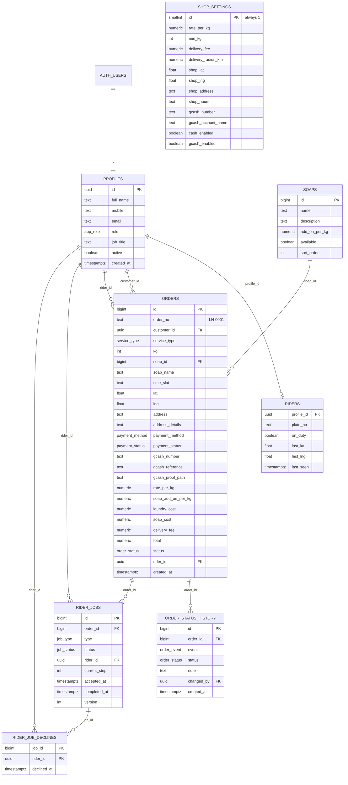

# Laundry HUB — Database (Supabase)

All SQL is in `supabase/migrations/`. Run the files **in order**.

| File | What it does |
|---|---|
| `0001_types.sql` | Enum types (roles, statuses, payment, job types) |
| `0002_tables.sql` | Tables, constraints, indexes |
| `0003_auth_and_helpers.sql` | New-user trigger, role helper functions, guard triggers |
| `0004_rls_policies.sql` | Row Level Security on every table + grants |
| `0005_order_functions.sql` | Price calculation, `quote_order`, `place_order`, GCash functions, status trigger |
| `0006_rider_functions.sql` | `accept_job`, `decline_job`, `advance_job` |
| `0007_admin_functions.sql` | `admin_dashboard`, `admin_reports`, `admin_users`, `admin_assign_rider`, `verify_gcash_payment` |
| `0008_storage_and_grants.sql` | `gcash-proofs` bucket rules, function permissions |
| `0009_seed_settings_and_soaps.sql` | Default prices, shop settings, the 4 soaps |
| `0010_seed_sample_orders.sql` | **Optional** sample customers + orders LH-0001…LH-0006 (screen A2) |
| `0011_rider_login_email.sql` | Lets riders sign in with their mobile number (Rider tab) |
| `0012_iloilo_shop_and_price.sql` | The Laundry Hub Iloilo location (PHJ6+X5C) and ₱20 per kg |
| `0013_cancellations.sql` | `cancel_order` (customer) and `release_job` (rider), `orders.cancel_reason` / `cancelled_at` |
| `0014_shop_gcash_number.sql` | Shop GCash number 0924 285 0309 (customers send payment here) |
| `0015_gcash_qr.sql` | `shop_settings.gcash_qr_path` + public `shop-public` bucket (ADMIN uploads the GCash QR Ph image) |

## How to run the files

### Option A: SQL Editor (no installs)
1. Supabase dashboard → **SQL Editor** → **New query**.
2. Open `0001_types.sql` in VS Code, copy everything, paste, click **Run**. It should say *Success. No rows returned*.
3. Repeat for `0002` … `0009` in order, then `0011`, `0012`, `0013`, `0014`, `0015` (and `0010` if you want sample data).

If a file fails halfway, fix the cause and run **that file** again. To start over completely,
run this first (it deletes all Laundry HUB data):

```sql
drop schema public cascade;
create schema public;
grant usage on schema public to anon, authenticated, service_role;
grant all on schema public to postgres, service_role;
drop trigger if exists on_auth_user_created on auth.users;
drop policy if exists gcash_proofs_insert_own on storage.objects;
drop policy if exists gcash_proofs_update_own on storage.objects;
drop policy if exists gcash_proofs_select on storage.objects;
```

### Option B: Supabase CLI
```
npx supabase login
npx supabase link --project-ref YOUR_REF
npx supabase db push
```

## Make yourself ADMIN, and create riders

1. Sign up on the website with your email (or in the dashboard: **Authentication → Users → Add user**).
   A `profiles` row with role `CUSTOMER` is created automatically.
2. **Table Editor → profiles** → find your row → set `role` to `ADMIN` (optionally `job_title` = `Owner`) → Save.
3. For a rider: create/sign up another account, set its `role` to `RIDER`. A `riders` row is
   created automatically; set its `plate_no` in **Table Editor → riders** (or later in Admin → Customers & riders).
4. `STAFF` works like `ADMIN` for orders, but only `ADMIN` can change prices, soaps and roles.

Or with SQL:
```sql
update public.profiles set role = 'ADMIN', job_title = 'Owner' where email = 'you@example.com';
update public.profiles set role = 'RIDER' where email = 'rider@example.com';
update public.riders set plate_no = 'NAB 1234'
  where profile_id = (select id from public.profiles where email = 'rider@example.com');
```

Edits made in the dashboard (no signed-in user) are always allowed. On the website,
only an ADMIN can change roles.

## Set the shop location

`0009` uses a placeholder location (Manila City Hall), so delivery pins more than 5 km from it are
rejected. Before testing delivery, set your real shop:

```sql
update public.shop_settings
   set shop_lat = 14.0000, shop_lng = 121.0000,
       shop_address = 'Your street, barangay, city', shop_hours = '8:00 AM – 8:00 PM',
       gcash_number = '09XXXXXXXXX', gcash_account_name = 'Your Name'
 where id = 1;
```

(Tip: right-click a place in Google Maps to copy its coordinates.)

## ERD



## Enums

| Type | Values |
|---|---|
| `app_role` | CUSTOMER, RIDER, ADMIN, STAFF |
| `service_type` | WALK_IN, PICKUP_DELIVERY |
| `payment_method` | CASH, GCASH |
| `payment_status` | UNPAID, PENDING_VERIFICATION, PAID, REJECTED |
| `order_status` | PENDING, WASHING, READY, OUT_FOR_DELIVERY, COMPLETED, CANCELLED |
| `order_event` | PLACED, PICKED_UP, the order statuses, PAYMENT_SUBMITTED / VERIFIED / REJECTED / RECEIVED |
| `job_type` | PICKUP, RETURN_DELIVERY |
| `job_status` | WAITING, AVAILABLE, ACCEPTED, IN_PROGRESS, COMPLETED, DECLINED, CANCELLED |

## Order and job life cycle

```
place_order ──▶ order PENDING
  delivery: PICKUP job AVAILABLE + RETURN_DELIVERY job WAITING
rider accept_job(PICKUP) → advance_job ×4
  step 3 "Confirm pickup"   → history PICKED_UP
  step 4 "Drop off at shop" → order WASHING
admin sets READY            → RETURN_DELIVERY job AVAILABLE (or ACCEPTED if a rider was assigned)
rider accept_job(RETURN) → advance_job ×4 (GCash) or ×5 (Cash)
  step 1 "Picked up at shop" → order OUT_FOR_DELIVERY
  step 4 "Cash received"     → payment PAID (cash only)
  last  "Mark as delivered"  → order COMPLETED
admin sets CANCELLED        → open jobs CANCELLED
customer cancel_order       → only while PENDING and the PICKUP job is before step 3 → CANCELLED
rider release_job           → only before taking the laundry (PICKUP step < 3, RETURN step 0)
                              job back to AVAILABLE (RETURN: WAITING if the order is not READY yet),
                              hidden from that rider, history note; the order stays active
```

Walk-in orders have no rider jobs; the admin moves them PENDING → WASHING → READY → COMPLETED.
Every status change is written to `order_status_history` by a trigger.

## API (called from Java over REST)

Base URL `SUPABASE_URL/rest/v1`. Headers: `apikey: <publishable key>`,
`Authorization: Bearer <user access token>`.

| RPC (`POST /rest/v1/rpc/<name>`) | Who | Body |
|---|---|---|
| `quote_order` | signed in | `p_service_type, p_kg, p_soap_id` |
| `place_order` | CUSTOMER | `p_service_type, p_kg, p_soap_id, p_time_slot, p_payment_method, p_lat, p_lng, p_address, p_address_details, p_gcash_reference, p_gcash_number` |
| `attach_gcash_proof` | order owner | `p_order_id, p_path` |
| `resubmit_gcash` | order owner | `p_order_id, p_reference, p_gcash_number` |
| `accept_job` | on-duty RIDER | `p_job_id` |
| `decline_job` | RIDER | `p_job_id` |
| `advance_job` | job's rider | `p_job_id` |
| `release_job` | job's rider | `p_job_id, p_reason` (gives the job back before the laundry is taken) |
| `cancel_order` | order owner | `p_order_id, p_reason` (PENDING and not picked up; reason saved as `Cancelled by customer: …`) |
| `rider_login_email` | anyone | `p_mobile` (returns a RIDER's e-mail for mobile sign-in) |
| `admin_dashboard` | ADMIN/STAFF | `{}` |
| `admin_reports` | ADMIN/STAFF | `p_from, p_to` (dates `YYYY-MM-DD`) |
| `admin_users` | ADMIN/STAFF | `p_role` (`CUSTOMER`, `RIDER`, `STAFF`) |
| `admin_assign_rider` | ADMIN/STAFF | `p_order_id, p_rider_id` (null = unassign) |
| `verify_gcash_payment` | ADMIN/STAFF | `p_order_id, p_approve, p_note` |

Errors come back as JSON `{"code": "PT409", "message": "This booking was already taken."}`.
The HTTP status matches the code (`PT400` → 400, `PT403` → 403, `PT409` → 409). Show `message` to the user.

Plain table reads/writes use PostgREST, e.g.
`GET /rest/v1/orders?select=*,soaps(name)&order=created_at.desc` (RLS limits the rows),
`PATCH /rest/v1/riders?profile_id=eq.<id>` with `{"on_duty": true}`.

## Security summary

- RLS is enabled on every table; signed-out users can only read `soaps` and `shop_settings`.
- Customers cannot insert orders directly; `place_order` recalculates prices from
  `shop_settings` and `soaps` and checks the 8 kg minimum, the pin and the delivery radius.
- `accept_job` uses `UPDATE … WHERE status = 'AVAILABLE'`, so two riders can never both win.
- Only ADMIN can change roles, prices and soaps; riders cannot change their plate number.
- GCash screenshots live in the private bucket `gcash-proofs/<user id>/<order no>.jpg`;
  customers access only their own folder, ADMIN/STAFF can read all.

## Tested

The migrations were run against a local Postgres (PGlite) with stub `auth`/`storage` schemas,
and 52 checks passed: guide prices (₱410, ₱516, ₱240, 7 kg → 8 kg), RLS per role, the
accept race, all rider steps, GCash reject/resubmit/verify, storage folders, admin reports,
and the sample seed (reproduces A2: ₱410, ₱240, ₱516, ₱324, ₱300, ₱585).
