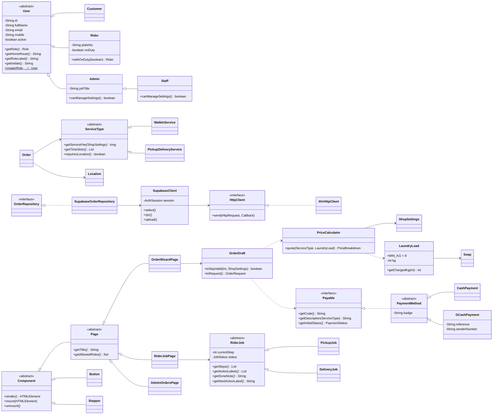

# Laundry HUB — Object-Oriented Design

The whole application (models, prices, validation, pages, routing, Supabase calls, maps) is Java,
compiled to JavaScript by TeaVM. This page shows where each OOP pillar is used. Paths are relative to
`src/main/java/com/laundryhub/`. In the code, every example is marked with a `// OOP: <pillar>` comment
(search the project for `OOP:`).

## 1. Encapsulation — data is private and changes only through checked methods

| Where | What is hidden / protected |
|---|---|
| `model/User.java:13–18` | `id`, `fullName`, `email`, `mobile`, `active` are `private final`; read through getters; the constructor rejects an empty id. |
| `model/LaundryLoad.java:24–29` | The constructor throws `InvalidWeightException` for 0 kg or more than 200 kg, so an invalid load can never exist. |
| `model/GCashPayment.java:25` | The constructor validates the 13-digit reference and the 09XXXXXXXXX sender number and stores them without spaces. |
| `model/ShopSettings.java:43`, `model/Soap.java:24`, `model/Location.java:23` | Prices, minimum load, radius, coordinates are validated when the object is created; objects are immutable afterwards. |
| `model/RiderJob.java:23` | Job progress (`currentStep`, `status`) has no setters — it only changes on the server through `advance_job`. |
| `service/OrderDraft.java:19` | The wizard state changes only through setters that keep it consistent (changing the service clears the time slot). |
| `repository/SupabaseClient.java:24` | Access/refresh tokens and the refresh logic are private; repositories only call `select`, `rpc`, `upload`. |
| `ui/Component.java:14`, `ui/Button.java:34`, `util/JsonObject.java:14` | DOM element and component state are private; setters keep the screen in sync. |
| Money | Always `long` centavos inside the model (no floating-point rounding errors); formatted by `util/MoneyFormatter`. |

## 2. Inheritance — "is-a" hierarchies that reuse common code

| Parent | Children | Shared in the parent |
|---|---|---|
| `model/User` (abstract) | `Customer`, `Rider`, `Admin` → `Staff` | id, name, e-mail, mobile, initials, first name |
| `model/ServiceType` (abstract) | `WalkInService`, `PickupDeliveryService` | `fromCode`, `all()` |
| `model/PaymentMethod` (abstract, implements `Payable`) | `CashPayment`, `GCashPayment` | badge, `fromCode` |
| `model/RiderJob` (abstract) | `PickupJob`, `DeliveryJob` | step states, next button label, `isDone`, total steps |
| `ui/Component` (abstract) | `Page` (abstract) → 21 pages; `Button`, `Card`, `Stepper`, `Chip`, `Badge`, … | `getElement`, `mount`, `unmount`, `rerender` |
| `exception/LaundryHubException` | `ValidationException` → `InvalidWeightException`, `InvalidPaymentException`; `ApiException` | one type to catch |

## 3. Polymorphism — the same call does the right thing for each subclass

| Call | Implementations | Used by |
|---|---|---|
| `user.getHomeRoute()` (`model/User.java:47`) | `Customer.java:30` → `#/home`, `Rider.java:65` → `#/rider`, `Admin.java:44` → `#/admin` | sign in sends each role to its home without `if/else` on the role |
| `admin.canManageSettings()` | `Admin.java:34` → true, `Staff.java:23` → false | Pricing and Users pages decide read-only mode |
| `service.getServiceFee(settings)` (`model/ServiceType.java:29`) | `WalkInService.java:41` → ₱0, `PickupDeliveryService.java:42` → delivery fee | `service/PriceCalculator.java:50` |
| `payment.getDescription(service)` | `CashPayment.java:29` ("Pay the rider upon delivery" / "Pay at the counter"), `GCashPayment.java:63` | payment cards |
| `job.getSteps()` / `getActionLabels()` / `getDoneNote()` (`model/RiderJob.java:58`) | `PickupJob.java:42`, `DeliveryJob.java:47` (cash orders get "Cash collected") | rider job page R2/R3/R4 |
| `component.render()` | every component and page | `Router` mounts any `Page` the same way |
| `httpClient.send(...)` | `repository/XhrHttpClient.java:19` (browser) and the fake in `SupabaseClientTest` | `SupabaseClient` |
| Factories | `User.create(role, …)` (`model/User.java:110`), `RiderJob.create(type, …)` (`model/RiderJob.java:137`) | mappers return the right subclass |
| Overloading | `Badge.of(OrderStatus)` next to `new Badge(text, tone, large)` | status badges |

## 4. Abstraction — code depends on contracts, not on details

| Abstraction | Concrete classes | Why |
|---|---|---|
| `model/Payable` (interface) | `PaymentMethod` → `CashPayment`, `GCashPayment` | the wizard only needs code, name, description, initial status |
| `repository/ProfileRepository`, `CatalogRepository`, `OrderRepository`, `RiderJobRepository`, `AdminRepository` (interfaces) | `Supabase…Repository` | pages never see URLs or JSON; tests can use fakes |
| `repository/HttpClient` (interface) | `XhrHttpClient` (browser), fake in tests | `SupabaseClient` is plain Java and unit-tested on the JVM |
| `repository/SessionStore` (interface) | `BrowserSessionStore` (localStorage), memory store in tests | "Remember me" without coupling to the browser |
| `model/User`, `ServiceType`, `RiderJob`, `ui/Component`, `ui/Page` (abstract classes) | see Inheritance | callers work with the abstract type |

## UML class diagram



## Layers

```
ui.pages  ──>  ui (components)  ──>  service (pure Java)  ──>  model (pure Java)
    │                                       ▲
    └──────────────>  repository (interfaces) ── Supabase…Repository ── SupabaseClient ── HttpClient
```

`model`, `service` and `util` never touch browser APIs, so 87 JUnit tests run them on the normal JVM
(`mvnw test`): prices (₱410 / ₱516 / ₱240 / 7 kg → 8 kg), validation, rider steps, the order timeline,
the wizard rules, CSV export, the Supabase client (with a fake `HttpClient`) and the JSON mapper.
